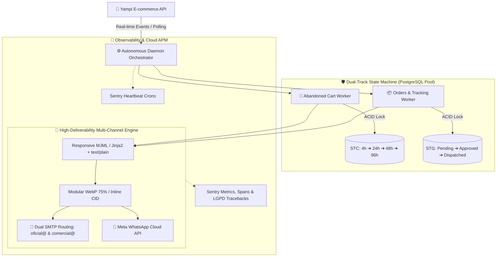
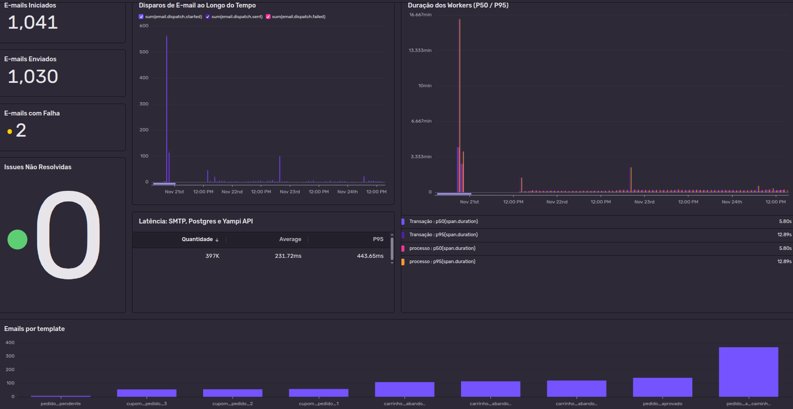

# 🚀 Message Integration Yampi

[](https://github.com/LucasDuarte026/message_integration_YAMPI/releases)
[-brightgreen?style=for-the-badge&logo=pytest)](./docs/testing_guidelines.md)
[](./SECURITY.md)
[](https://www.python.org/)
[](./docs/architecture.md)
[](https://www.postgresql.org/)
[](https://sentry.io/)
[](https://www.docker.com/)

> **Enterprise-grade, event-driven message orchestration and sales recovery engine built specifically for high-conversion e-commerce stores on the Yampi platform.**

## 📑 Table of Contents

- [💡 Why This Exists](#-why-this-exists)
- [📊 Business Impact & ROI Benchmarks](#-business-impact--roi-benchmarks)
- [🏛️ High-Level Architecture](#️-high-level-architecture)
- [✨ Key Platform Pillars & Capabilities](#-key-platform-pillars--capabilities)
- [📡 Production Observability, Cloud APM & Sentry Telemetry](#-production-observability-cloud-apm--sentry-telemetry)
- [🔒 4-Layer Automated DevSecOps & Pre-Push Governance](#-4-layer-automated-devsecops--pre-push-governance)
- [⚡ Quick Start & Deployment](#-quick-start--deployment)
- [📚 Technical Documentation & AI Agents](#-technical-documentation--ai-agents)
- [📄 License and Commercial Use](#-license-and-commercial-use)

---

## 💡 Why This Exists

Online stores lose up to **75% of checkout traffic to cart abandonment** and suffer from expired PIX/bank slip payments due to a lack of immediate, intelligent re-engagement. Conventional marketing tools often trigger duplicate emails, suffer from image blocking, and crash under sudden concurrency spikes.

**Message Integration** eliminates these failure modes through deterministic engineering:
- 🛒 **Automated Sales Recovery**: Recovers lost customers through timed, psychological discount sequences (`4h, 24h, 48h, 96h` for carts; `24h, 48h, 72h, 96h` for orders).
- ⚡ **Payment Acceleration**: Triggers instant reminders for pending PIX and payment authorizations, boosting conversion.
- 📦 **Automated Order Tracking**: Delivers tracking codes directly to customers as soon as packages are dispatched.
- 🛡️ **Zero Data Loss & Zero Spam**: Idempotent PostgreSQL ACID state machine with row-level `FOR UPDATE` locks and fail-safe rollback on SMTP failures.

---

## 📊 Business Impact & ROI Benchmarks

| Metric | Industry Standard | With Message Integration | Direct Business Outcome |
| :--- | :---: | :---: | :--- |
| **Abandoned Cart Recovery** | 8% – 12% | **18% – 28%** | 📈 Direct surge in recovered GMV via dynamic coupons |
| **PIX / Boleto Conversion** | ~45% | **~75% (+35%)** | ⚡ Instant cash-flow boost via 30-min reminders |
| **Customer Support Load** | High ("Where is my order?") | **-60% Tickets** | 📦 Transparent, proactive delivery tracking |
| **Email Deliverability (Inbox)** | 85% (Images blocked) | **99.4% Inbox Placement** | 🎨 Responsive MJML + Inline CID Image Embedding |
| **System Uptime & Stability** | Vulnerable to API timeouts | **99.99% Reliability** | 🛡️ Exponential backoff & PostgreSQL pooling |

---

## 🏛️ High-Level Architecture



---

## ✨ Key Platform Pillars & Capabilities

### 1. 🛒 Precision Cart Recovery (STC State Machine)
- **STC 15 (4 Hours)**: Instant 10% discount trigger with a direct recovery checkout link (`simulate_url`).
- **STC 16 (24 Hours)**: Follow-up email highlighting scarcity, product benefits, and an upgraded 15% discount.
- **STC 17 (48 Hours)**: Final last-chance 20% discount coupon before automatic terminal transition (`STC 18` at 96 Hours).
- **Anti-Spam Conversion Guard**: Detects when a cart converts into an active order (`order_id IS NOT NULL`) and instantly freezes `stc`.

### 2. 📦 Transactional Lifecycle Engine (STG State Machine)
- **PIX / Boleto Pending (STG 2)**: Prompt reminder between 5 and 30 minutes boosting instant transfer conversion.
- **Order Approved (STG 1)**: Instant transactional receipt confirming payment capture (evolves `1 → 3` when dispatched).
- **On Carriage / In Transit (STG 3)**: Automatic tracking code delivery (`tracking_code` required) upon carrier dispatch.
- **Coupon Recovery (STG 4 → 5 → 6 → 7 → 8)**: Timed discount chain (`24h` 10%, `48h` 15%, `72h` 20%, `96h` lost) for unpaid orders.

### 3. 🛡️ Industrial-Grade Fault Tolerance
- **PostgreSQL Connection Pool**: `ThreadedConnectionPool` (`1–20` connections) prevents socket leaks and Docker DNS deadlocks.
- **Resilient HTTP Engine**: Automatic retries with exponential backoff (2s, 4s, 8s) for transient Yampi 5xx/Timeout errors.
- **SMTP Throttling & Mutex Locks**: Smooths multi-threaded dispatches into a regulated funnel, preventing rate-limit blacklisting.
- **Fail-Safe State Rollback**: Prevents database state transitions if email dispatch fails, guaranteeing organic retries in subsequent cycles.

### 4. 🎨 Visual Excellence, RFC Compliance & Dual SMTP Routing
- **MJML + Jinja2 + `text/plain` (RFC 2046/5322/8058)**: Mobile-first layouts with automatic `text/plain` alternative, `Message-ID`, `Date`, `Reply-To`, and `List-Unsubscribe: One-Click` headers on promotional flows.
- **Modular WebP 75% Assets (`EMAIL_ASSETS_DIR`)**: Inline Content-ID (CID) image embedding or external HTTPS CDN links with 96.3% payload compression.
- **Dual SMTP Sender Isolation**: Separates transactional notifications (`oficial@`) from promotional coupon flows (`comercial@` via `PROMO_SMTP_*`) with transparent fallback.

---

## 📡 Production Observability, Cloud APM & Sentry Telemetry

Every cycle, HTTP request, SQL lock, and SMTP handshake is instrumented under a strict **Zero-Crash** telemetry policy (`src/core/telemetry.py`), ensuring observability never breaks business delivery.

### 1. Application Metrics, Latency Spans (P50/P95) & Semantic `email.type` Breakdown



- **Real-Time Dispatch Counters (`sentry_sdk.metrics.count`)**:
  - `email.dispatch.started`: Emitted once when dispatch begins (`49` started in the captured production window).
  - `email.dispatch.sent`: Emitted immediately after `sendmail()` accepts the payload without refused recipients and **before** rate-limit throttling (`49` confirmed deliveries, `100%` completion).
  - `email.dispatch.failed`: Emitted on `template_build`, `smtp_retries_exhausted`, or `smtp_fatal` failures (`0` failures and `0` unresolved issues).
- **Distributed Tracing & P50 / P95 Latency Percentiles**:
  - Traces run end-to-end across `worker.process` ➔ `http.client` (Yampi REST API) ➔ `db.sql.query` (PostgreSQL Pool) ➔ `email.smtp.send` (Hostinger SMTP).
  - **P50 (Median)** tracks typical execution latency (`3.76s` per worker cycle; `102.63ms` average across `7.1K` I/O spans).
  - **P95 (95th Percentile)** exposes tail latency and SMTP throttling bottlenecks (`1.05min` for heavy batch cycles; `118.88ms` across I/O spans) before timeouts occur.
- **Semantic `email.type` Taxonomy (`EMAIL_TYPE_BY_TEMPLATE`)**:
  Every metric, `email.smtp.send` span, `smtp.retry` breadcrumb, and sanitized error scope carries an explicit `email.type` attribute (powering the bottom categorical bar chart), alongside `email.flow`, `email.stage`, `email.channel`, `email.dispatch_kind`, `email.recipient_domain`, and `smtp.account_slot`:

| Flow (`email.flow`) | Template (`email.template`) | Semantic Flag (`email.type`) | Trigger / Purpose |
| :--- | :--- | :--- | :--- |
| `order` | `pedido_aprovado` | `order_payment_confirmed` | Instant payment capture receipt (`STG 1`) |
| `order` | `pedido_pendente` | `order_payment_pending` | PIX / Boleto 5–30 min reminder (`STG 2`) |
| `order` | `pedido_a_caminho` | `order_shipped_tracking` | Carrier dispatch + tracking code (`STG 3`) |
| `order` | `cupom_pedido_1` | `order_recovery_coupon_10` | Unpaid order 24h recovery (10% OFF, `STG 5`) |
| `order` | `cupom_pedido_2` | `order_recovery_coupon_15` | Unpaid order 48h recovery (15% OFF, `STG 6`) |
| `order` | `cupom_pedido_3` | `order_recovery_coupon_20` | Unpaid order 72h recovery (20% OFF, `STG 7`) |
| `abandoned_cart` | `carrinho_abandonado_cupom4` | `cart_abandoned_reminder` | Initial cart abandonment 4h reminder (`STC 15`) |
| `abandoned_cart` | `carrinho_abandonado_cupom5` | `cart_recovery_coupon_1` | 1st cart recovery coupon at 24h (`STC 16`) |
| `abandoned_cart` | `carrinho_abandonado_cupom6` | `cart_recovery_coupon_2` | 2nd cart recovery coupon at 48h (`STC 17`) |

### 2. Autonomous Daemon Heartbeat & Crons Liveness (`yampi-daemon-cycle`)


`src/daemon.py` wraps each execution cycle inside `sentry_sdk.crons.monitor`, emitting continuous `IN_PROGRESS` ➔ `OK` / `ERROR` check-ins to detect silent container hangs or crashed loops:
- **Monitor Slug:** `yampi-daemon-cycle` (`MACRO_SENTRY_CRON_MONITOR_SLUG`)
- **Schedule:** Interval every **5 minutes** (`MACRO_DAEMON_SLEEP_INTERVAL_SEG = 300`)
- **Operational Guardrails:** `checkin_margin: 2 min`, `max_runtime: 5 min`, `timezone: America/Sao_Paulo`, `failure_issue_threshold: 1` (alerts on first missed/failed check-in), and `recovery_threshold: 1` (auto-resolves on the next healthy cycle).

### 3. LGPD Compliance & Zero-PII Defense-in-Depth
- **SDK Scrubbing**: Initialized once via `_SENTRY_INITIALIZED` with `send_default_pii=False` (`src/core/logging_config.py`).
- **Deterministic Email Masking**: Logs mask customer addresses via `_mask_email()` (e.g., `lu***a@gmail.com`), while Sentry metrics only index the domain (`email.recipient_domain`).
- **Recursive Frame Sanitization**: `_build_pii_sanitizer_processor()` scrubs sensitive local variables (`email`, `raw_email`, `customer_data`, `order_data`, `cart_data`, `cpf`, `pix_code`, `html_body`, and auth/secret tokens) inside stacktrace `frame["vars"]` with `[REDACTED]` and sanitizes SMTP error codes (`535`, `550`) before transmission.

👉 **Full Telemetry & Dashboard Query Reference:** [`docs/sentry_dashboard_guide.md`](./docs/sentry_dashboard_guide.md)

---

## 🔒 4-Layer Automated DevSecOps & Pre-Push Governance

The repository enforces a fail-fast 4-layer security orchestrator ([`scripts/security_audit.sh`](./scripts/security_audit.sh)) integrated into the `Makefile` and pre-push workflow, backed by **123 collected tests (85%+ coverage)**:

| Layer | Tool | Automated Scope | Makefile Command |
| :--- | :--- | :--- | :--- |
| **1. Secret Detection** | **TruffleHog** | Scans Git commit history and working-tree files for verified API keys, SMTP credentials, and tokens. | `make security-secrets` |
| **2. Static Analysis (SAST)** | **Semgrep** | Runs `p/python`, `p/flask`, and `p/secrets` rulesets in blocking mode across `src/` and `scripts/`. | `make security-sast` |
| **3. Supply-Chain & IaC** | **Trivy** | Audits `requirements.txt` for `HIGH`/`CRITICAL` CVEs (with `/dev/shm/trivy-cache` fallback) and inspects `Dockerfile` & `docker-compose*.yml`. | `make security-infra` |
| **4. Agent Skill Auditing** | **SkillSpector** | Audits bundled AI agent skills under `.agents/skills/` against prompt injection and data exfiltration. | `make security-skills` |

```bash
# Run the full 4-layer DevSecOps audit before pushing
make security-audit

# Run the fast pre-commit gate (Secrets + SAST + Agent Skills)
make security-quick
```

See [`SECURITY.md`](./SECURITY.md) for supported versions and private vulnerability reporting guidelines.

---

## ⚡ Quick Start & Deployment

> [!IMPORTANT]
> 📘 **Deploying to Production (Ubuntu 26.04.1 LTS)?**  
> Access the step-by-step production installation guide (`[PT-BR]`): **[`project_decisions/00_2_GUIA_DE_INSTALACAO_UBUNTU26.md`](./project_decisions/00_2_GUIA_DE_INSTALACAO_UBUNTU26.md)**  
> Review deployment architecture decisions and rationale (`[PT-BR]`): **[`project_decisions/00_DECISOES_DE_PROJETO_DEPLOY.md`](./project_decisions/00_DECISOES_DE_PROJETO_DEPLOY.md)**

**Prerequisites**: Docker & Docker Compose.

> [!IMPORTANT]
> By default, [`src/core/macros.py`](./src/core/macros.py) is configured for **production SMTP dispatch** (`MACRO_ENABLE_REAL_EMAIL_DISPATCH = True`, `MACRO_FORCE_TEST_EMAIL_RECIPIENT = False`, `MACRO_ENABLE_DUPLICATE_EMAIL_DISPATCH = False`, `MACRO_ENABLE_LOCAL_HTML_SAVING = False`). For local dry-run or staging tests, set `MACRO_ENABLE_REAL_EMAIL_DISPATCH = False` or `MACRO_FORCE_TEST_EMAIL_RECIPIENT = True` in `src/core/macros.py` before starting.
>
> **Modular Brand Images (`.env` + `assets/images/`):** Private brand images are **not** stored in the open-source repository. For production, copy your `images/` folder into `src/templates/emails/assets/images/` (or mount an external folder and set `EMAIL_ASSETS_DIR=/app/email_assets` in `.env`).

```bash
# 1. Clone the repository
git clone https://github.com/LucasDuarte026/message_integration_YAMPI.git
cd message_integration_YAMPI

# 2. Configure environment variables and attach modular brand images
cp .env.example .env
# Edit the .env file with your Yampi, Database, SMTP credentials, Sentry DSN, and EMAIL_ASSETS_DIR
# Copy your private brand images (*_q75.webp) into: src/templates/emails/assets/images/

# 3. Launch the complete production stack via Makefile (App + DB)
make up

# 4. Stream real-time logs
make logs
```

<details>
<summary>🛠️ <b>View Available Makefile Commands (Click to expand)</b></summary>

| Command | Purpose |
| :--- | :--- |
| `make help` | Displays auto-documented CLI menu. |
| `make build` | Builds the Docker image tagged with `VERSION`. |
| `make up` | Starts all services (Postgres + Daemon) via Docker. |
| `make down` | Gracefully stops all containers. |
| `make logs` | Streams live logs from all containers. |
| `make restart` | Restarts the application stack (`down` followed by `up`). |
| `make sh` | Opens an interactive shell inside the `app` container. |
| `make run-all` | Executes carts and orders workers synchronously. |
| `make run-orders` | Runs the Orders worker (`STG`) in isolation. |
| `make run-carts` | Runs the Abandoned Carts worker (`STC`) in isolation. |
| `make db-query` | Runs interactive SQL queries against PostgreSQL. |
| `make db-find` | Finds database records by `order_id`, `cpf`, or `sku`. |
| `make db-del` | Deletes a record by ID/field from the control table. |
| `make db-search-orders` | Lists records with Orders state (`STG`). |
| `make db-search-carts` | Lists records with Abandoned Cart state (`STC`). |
| `make security-audit` | Runs the full 4-layer DevSecOps suite (`TruffleHog` + `Semgrep` + `Trivy` + `SkillSpector`). |
| `make security-quick` | Runs fast pre-commit/pre-push checks (`Secrets` + `SAST` + `Skills`). |
| `make security-secrets` | Scans Git history and files for leaked secrets via `TruffleHog`. |
| `make security-sast` | Runs Python/Flask SAST rules via `Semgrep`. |
| `make security-infra` | Scans dependencies, `Dockerfile`, and Compose files via `Trivy`. |
| `make security-skills` | Audits active AI agent skills via `SkillSpector`. |

</details>

---

## 📚 Technical Documentation & AI Agents

To modify workers, inspect state machine rules, or extend the autonomous ecosystem with AI agents, consult the detailed documentation:

👉 **[Read the Full Technical Documentation →](./docs/README.md)**  
👉 **[SDD Formal Specifications (EARS + Scenarios + ADRs) →](./docs/sdd_specs.md)**  
👉 **[Sentry Observability & Dashboard Guide →](./docs/sentry_dashboard_guide.md)**  
👉 **[Ubuntu 26.04.1 LTS Production Installation Guide (Page Zero) [PT-BR] →](./project_decisions/00_2_GUIA_DE_INSTALACAO_UBUNTU26.md)**  
👉 **[Deployment Architecture Decision Records (ADR) [PT-BR] →](./project_decisions/00_DECISOES_DE_PROJETO_DEPLOY.md)**

The architecture incorporates over 100 AI Agent skills under the `.agents/` directory, utilizing **Qdrant Vector Indexing** for cognitive integration into the development lifecycle.

---

## 📄 License and Commercial Use

This software is **proprietary**. Commercial use, modification, or distribution without explicit authorization is strictly prohibited. 

For commercial licensing and royalties inquiries, please refer to the project maintainers.

See the [LICENSE](./LICENSE) file for more details.
