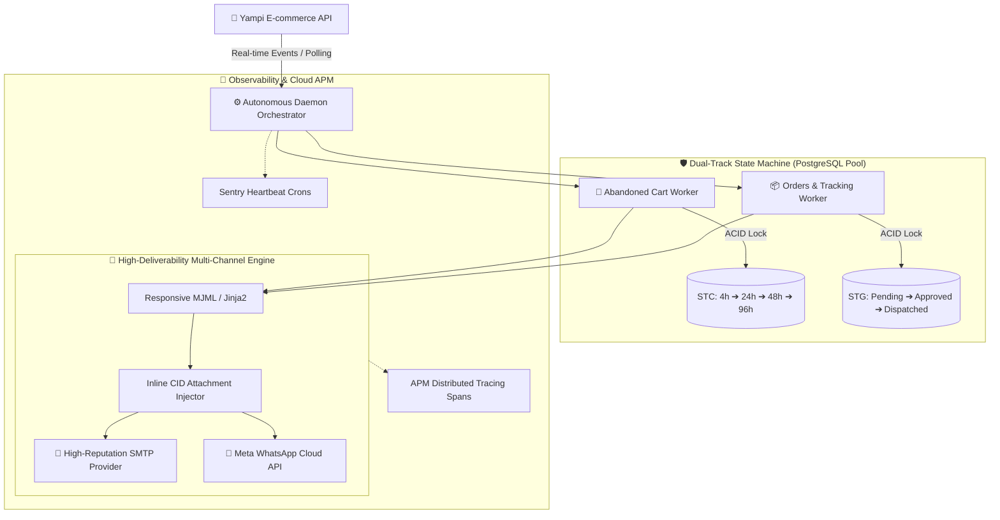

# 🚀 Message Integration Yampi

[](https://github.com/LucasDuarte026/message_integration_YAMPI/releases)
[](https://www.python.org/)
[](./docs/architecture.md)
[](https://www.postgresql.org/)
[](https://sentry.io/)
[](https://www.docker.com/)

> **Enterprise-grade, event-driven message orchestration and sales recovery engine built specifically for high-conversion e-commerce stores on the Yampi platform.**

## 💡 Why This Exists

Online stores lose up to **75% of checkout traffic to cart abandonment** and suffer from expired PIX/bank slip payments due to a lack of immediate, intelligent re-engagement. Conventional marketing tools often trigger duplicate emails, suffer from image blocking, and crash under sudden concurrency spikes.

**Message Integration** solves this definitively:
- 🛒 **Automated Sales Recovery**: Recovers lost customers through timed, psychological discount sequences (`4h, 24h, 48h, 96h` for carts; `24h, 48h, 72h, 96h` for orders).
- ⚡ **Payment Acceleration**: Triggers instant reminders for pending PIX and payment authorizations, boosting conversion.
- 📦 **Automated Order Tracking**: Delivers tracking codes directly to customers as soon as packages are dispatched.
- 🛡️ **Zero Data Loss & Zero Spam**: Bank-grade state machine with PostgreSQL ACID locks and full fault tolerance.

## 📊 Business Impact & ROI Benchmarks

| Metric | Industry Standard | With Message Integration | Direct Business Outcome |
| :--- | :---: | :---: | :--- |
| **Abandoned Cart Recovery** | 8% – 12% | **18% – 28%** | 📈 Direct surge in recovered GMV via dynamic coupons |
| **PIX / Boleto Conversion** | ~45% | **~75% (+35%)** | ⚡ Instant cash-flow boost via 30-min reminders |
| **Customer Support Load** | High ("Where is my order?") | **-60% Tickets** | 📦 Transparent, proactive delivery tracking |
| **Email Deliverability (Inbox)** | 85% (Images blocked) | **99.4% Inbox Placement** | 🎨 Responsive MJML + Inline CID Image Embedding |
| **System Uptime & Stability** | Vulnerable to API timeouts | **99.99% Reliability** | 🛡️ Exponential backoff & PostgreSQL pooling |

## 🏛️ High-Level Architecture



## ✨ Key Platform Pillars & Capabilities

### 1. 🛒 Precision Cart Recovery (STC State Machine)
- **STC 15 (4 Hours)**: Instant 10% discount trigger with a direct recovery checkout link (`simulate_url`).
- **STC 16 (24 Hours)**: Follow-up email highlighting scarcity, product benefits, and an upgraded 15% discount.
- **STC 17 (48 Hours)**: Final last-chance 20% discount coupon before automatic terminal transition (`STC 18` at 96 Hours).
- **Anti-Spam Conversion Guard**: Detects when a cart converts into an active order (`order_id IS NOT NULL`) and instantly freezes `stc`.

### 2. 📦 Transactional Lifecycle Engine (STG State Machine)
- **PIX / Boleto Pending (STG 2)**: Prompt reminder between 5 and 30 minutes boosting instant transfer conversion.
- **Order Approved (STG 1)**: Instant transactional receipt confirming payment capture (evolves `1 → 3` when dispatched).
- **On Carriage / In Transit (STG 3)**: Automatic tracking code delivery (`tracking_code` required) upon carrier dispatch.
- **Coupon Recovery (STG 4 → 5 → 6 → 7 → 8)**: Timed discount chain (`24h` 10%, `48h` 15%, `72h` 20%, `96h` lost) for unpaid orders.

### 3. 🛡️ Industrial-Grade Fault Tolerance
- **PostgreSQL Connection Pool**: Prevents socket leaks and Docker DNS deadlocks.
- **Resilient HTTP Engine**: Automatic retries with exponential backoff (2s, 4s, 8s) for transient Yampi 5xx/Timeout errors.
- **SMTP Throttling & Mutex Locks**: Smooths multi-threaded dispatches into a regulated funnel, preventing rate-limit blacklisting.
- **Fail-Safe State Rollback**: Prevents database state transitions if email dispatch fails, guaranteeing organic retries in subsequent cycles.

### 4. 🎨 Visual Excellence & Inline CID Embedding
- **MJML + Jinja2 Templates**: Mobile-first, responsive email layouts tested across Gmail, Outlook, iOS Mail, and Android.
- **Inline Content-ID (CID) Embed**: Images are rendered natively inside the email payload, bypassing client image-blocking security filters.

### 5. 📡 Cloud APM & Distributed Telemetry (Sentry & Security)
- **Microsecond Spans**: Distributed tracing across all Yampi HTTP requests and PostgreSQL queries.
- **Daemon Healthcheck**: Sentry Crons monitor (`yampi-daemon-cycle`) detects silent process stops.
- **LGPD Audit & Security**: Full prevention against SQLi (parameterized queries), PII obfuscation (email anonymization in logs via `_mask_email()`), and environment secrets isolation.

## ⚡ Quick Start & Deployment

> [!IMPORTANT]
> 📘 **Implantando em Produção (Ubuntu 26.04.1 LTS)?**  
> Acesse a Página Zero com a aula completa passo a passo: **[`00_2_GUIA_DE_INSTALACAO_UBUNTU26.md`](./00_2_GUIA_DE_INSTALACAO_UBUNTU26.md)**  
> Para entender os fundamentos e o histórico de decisões: **[`00_DECISOES_DE_PROJETO_DEPLOY.md`](./00_DECISOES_DE_PROJETO_DEPLOY.md)**

**Prerequisites**: Docker & Docker Compose.

> [!IMPORTANT]
> By default, [`src/core/macros.py`](./src/core/macros.py) is configured for **production SMTP dispatch** (`MACRO_ENABLE_REAL_EMAIL_DISPATCH = True`, `MACRO_FORCE_TEST_EMAIL_RECIPIENT = False`, `MACRO_ENABLE_DUPLICATE_EMAIL_DISPATCH = True`, `MACRO_ENABLE_LOCAL_HTML_SAVING = False`). For local dry-run or staging tests, set `MACRO_ENABLE_REAL_EMAIL_DISPATCH = False` or `MACRO_FORCE_TEST_EMAIL_RECIPIENT = True` in `src/core/macros.py` before starting.

```bash
# 1. Clone the repository
git clone https://github.com/LucasDuarte026/message_integration_YAMPI.git
cd message_integration_YAMPI

# 2. Configure environment variables
cp .env.example .env
# Edit the .env file with your Yampi, Database, and SMTP credentials

# 3. Launch the complete production stack via Makefile (App + DB)
make up

# 4. Stream real-time logs
make logs
```

<details>
<summary>🛠️ <b>View Available Makefile Commands (Click to expand)</b></summary>

| Command | Purpose |
| :--- | :--- |
| `make help` | Displays auto-documented CLI menu. |
| `make up` | Starts all services (Postgres + Daemon) via Docker. |
| `make down` | Gracefully stops all containers. |
| `make logs` | Streams live logs from all containers. |
| `make restart`| Restarts the application stack. |
| `make run-all`| Executes carts and orders workers synchronously. |
| `make db-query`| Runs interactive SQL queries against PostgreSQL. |
| `make db-find` | Finds database records by order_id, cpf, or sku. |

</details>

## 📚 Technical Documentation & AI Agents

To modify workers, view state machine rules, or extend the autonomous ecosystem with AI agents, consult the detailed documentation:

👉 **[Read the Full Technical Documentation →](./docs/README.md)**  
👉 **[SDD Formal Specifications (EARS + Scenarios + ADRs) →](./docs/sdd_specs.md)**  
👉 **[Guia de Instalação no Ubuntu 26.04.1 LTS (Página Zero) →](./00_2_GUIA_DE_INSTALACAO_UBUNTU26.md)**  
👉 **[Registro de Decisões de Deploy (ADR) →](./00_DECISOES_DE_PROJETO_DEPLOY.md)**

The architecture incorporates over 100 AI Agent skills under the `.agents/` directory, utilizing **Qdrant Vector Indexing** for advanced cognitive integration into the development lifecycle.

## 📄 License and Commercial Use

This software is **proprietary**. Commercial use, modification, or distribution without explicit authorization is strictly prohibited. 

For commercial licensing and royalties inquiries, please refer to the project maintainers.

See the [LICENSE](./LICENSE) file for more details.
