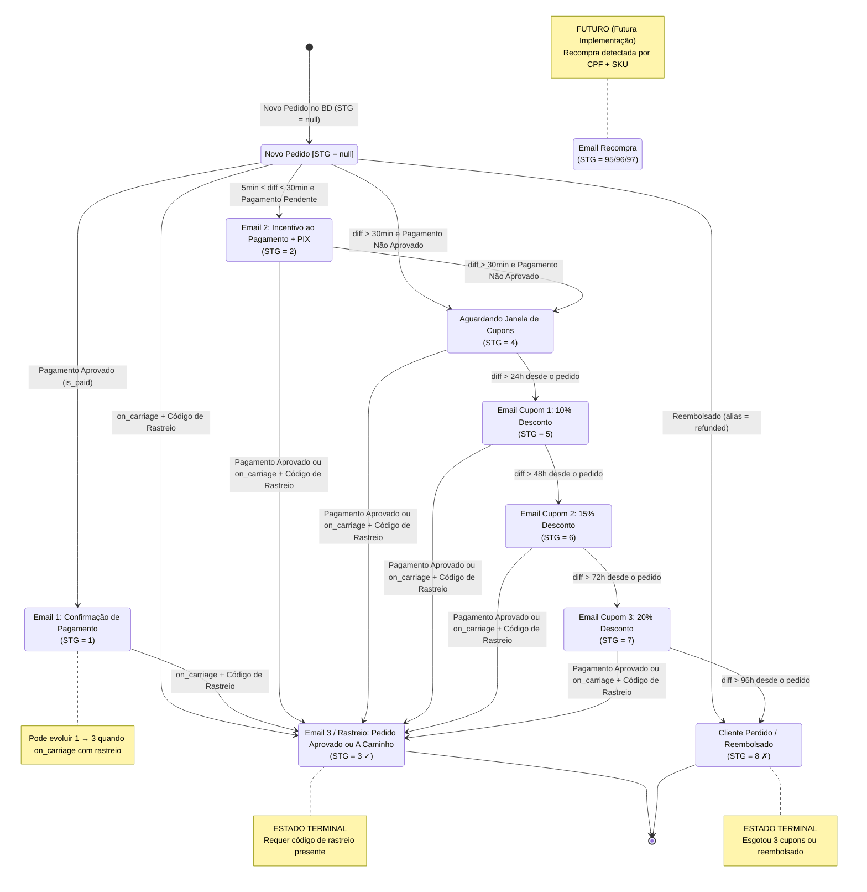
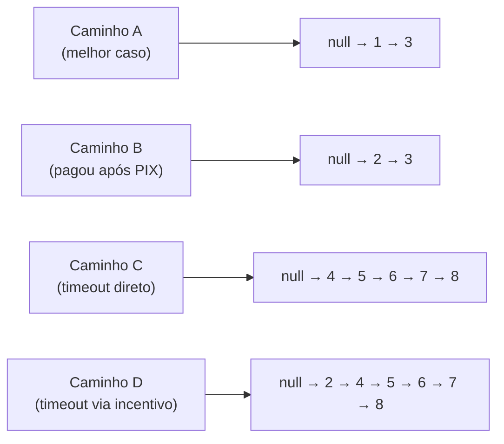

# Diagrama de Estados — STG (Pedidos)

**Data de Criação:** 2026-07-21  
**Referência:** [email_state_machine.md](../email_state_machine.md) | [Índice de Diagramas](./README.md)

---

## Legenda

- **Referência temporal (UTC-First)**: `diff = get_now_utc() - data_pedido` (normalizado para UTC a partir do banco e protegido com `COALESCE(LEAST(...))`)
- **Círculos duplos** `[*]`: estados terminais (sistema pula na próxima iteração: `stg ∈ {3, 8, 95, 96, 97}`)
- **Condições entre colchetes**: lógica verificada pelo worker de pedidos (`src/workers/orders.py`)
- **Ações entre parênteses**: email enviado e/ou marcação no banco

---

## Diagrama



---

## Tabela Resumo de Transições

| De | Para | Condição Temporal | Condição de Pagamento / Status | Email | Terminal? |
|---|---|---|---|---|---|
| Qualquer (`!=3,8`) | `8` | qualquer | `alias == 'refunded'` | — | ✓ Sim |
| Qualquer (`!=3,8`) | `3` | qualquer | `on_carriage` **e** `tracking_code` presente | `pedido_a_caminho` | ✓ Sim |
| `null` | `1` | qualquer | Aprovado (`is_paid`) | `pedido_aprovado` | Não (`1→3` possível) |
| `null` | `2` | `5min ≤ diff ≤ 30min` | Pendente (`is_pending`) | `pedido_pendente` | Não |
| `null` | `4` | `diff > 30min` | Não aprovado | — | Não |
| `2, 4, 5, 6, 7` | `3` | qualquer | Aprovado (`is_paid`) **e** `tracking_code` presente | `pedido_aprovado` | ✓ Sim |
| `2` | `4` | `diff > 30min` | Não aprovado | — | Não |
| `4` | `5` | `diff > 24h` | Não aprovado | `cupom_pedido_1` (10%) | Não |
| `5` | `6` | `diff > 48h` | Não aprovado | `cupom_pedido_2` (15%) | Não |
| `6` | `7` | `diff > 72h` | Não aprovado | `cupom_pedido_3` (20%) | Não |
| `7` | `8` | `diff > 96h` | Não aprovado | — | ✓ Sim |


---

## Caminhos Completos Possíveis



---

## Regra de Entrada do Worker de Pedidos

```
PARA CADA pedido elegível (created_at <= 15 dias):
  1. cart_id ← pedido.metadata.cart_id (se ausente, ignora)
  2. data_pedido ← created_at || transactions[0].created_at || updated_at (convertido para UTC)
  3. UPSERT cart_id na email_status_table (FOR UPDATE + COALESCE(LEAST(data_pedido)))
     ├── EXISTE → UPDATE order_id, order_number, data_pedido, cpf, sku
     └── NÃO EXISTE → INSERT nova linha (stg=NULL, stc=NULL)
  4. Normalizar row["data_pedido"] para UTC e LER stg
  5. SE stg ∈ {3, 8, 95, 96, 97} → SKIP
  6. APLICAR transições conforme tabela acima (bloqueando STG 3 se sem tracking_code)
  7. SE email enviado com sucesso (True) → update_stg + timestamp_ultimo_email (UTC) + breadcrumb
     SE envio retornar False → abortar update_stg (retentativa no próximo ciclo)
```
