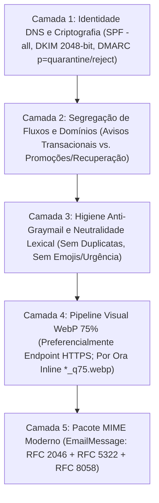

# Políticas de Entregabilidade, Domínios e Governança Antispam (SDD)

**Status:** Ativo / Norma Arquitetural de Entregabilidade  
**Versão Alvo:** `6.6.0`  
**Padrão:** SDD (*Spec-Driven Development*) · EARS (*Easy Approach to Requirements Syntax*) + Cenários `DADO / QUANDO / ENTÃO`  
**Documentos Relacionados:** [Especificações Formais SDD](./sdd_specs.md) · [Arquitetura do Sistema](./architecture.md) · [Máquina de Estados STG/STC](./email_state_machine.md) · [Diretrizes de Testes](./testing_guidelines.md)

---

## 1. Propósito e Arquitetura de Entregabilidade em 5 Camadas

Este documento especifica formalmente todas as regras de negócio, políticas técnicas e garantias operacionais adotadas pelo `message_integration` para assegurar entrega na caixa de entrada principal (*Inbox Placement*) junto aos grandes provedores (Google/Gmail, Yahoo Mail e Microsoft Outlook/Hotmail), eliminando os gatilhos que anteriormente levavam os disparos à caixa de Spam.

### Por que cada medida é indispensável para as companhias de tráfego de e-mail?
Desde **fevereiro de 2024**, Google e Yahoo (acompanhados pelas exigências da Microsoft para remetentes comerciais) passaram a rejeitar ou rebaixar automaticamente mensagens que falham em quatro eixos matemáticos:
1. **Autenticação e Alinhamento (`SPF`, `DKIM`, `DMARC`):** comprovam criptograficamente que o servidor emissor pertence à marca exibida no `From:` e impedem falsificação (*spoofing*).
2. **Integridade Estrutural e de Cabeçalhos (`RFC 5322` e `RFC 2046`):** mensagens sem `Message-ID`, `Date` ou alternativa `text/plain` acumulam penalidade base de **+5,4 a +7,5 pontos** em motores como o SpamAssassin (onde **5,0** já classifica como Spam).
3. **Peso de Payload e Proporção Texto/Imagem:** anexos Base64 gigantes disparavam a regra `HTML_IMAGE_ONLY_08` e o corte de **102 KB do Gmail** (*Gmail Clipping*), ocultando CNPJ e links de descadastramento no rodapé.
4. **Engajamento e Baixo Índice de Reclamações (`RFC 8058` e Anti-Graymail):** o limite saudável de denúncias de spam no Google Postmaster Tools é **< 0,10%**, com zona crítica de bloqueio em **0,30%**. Fornecer `List-Unsubscribe: One-Click` e eliminar cópias não lidas (*Graymail*) protege diretamente essa métrica.

---

## 2. Política de Domínios e Segregação de Tráfego (Avisos vs. Promoções)

Os algoritmos de reputação avaliam o domínio remetente separando o comportamento de abertura e reclamação por identidade emissora. Misturar notificações essenciais de compra com ofertas comerciais de desconto expõe recibos e códigos de rastreio a penalidades causadas por clientes que marcam cupons como spam.

| Classificação do Fluxo | Estados da Máquina (`STG` / `STC`) | Natureza e Sinalizador (`is_promotional`) | Conta / Remetente Atual & Evolução de Subdomínio | Cabeçalhos RFC 8058 (`List-Unsubscribe`) |
| :--- | :--- | :--- | :--- | :--- |
| **Avisos Transacionais Puros** | `STG 1` (`pedido_aprovado`), `STG 3` (`pedido_a_caminho`) | Estritamente operacional (`is_promotional = False`). Alta taxa de abertura esperada. | **`oficial@elevemeloja.com.br`** (pool `_server`). Evolução futura: `notifica.elevemeloja.com.br`. | **Não injetado** (comunicação contratual essencial do pedido). |
| **Lembrete de Pagamento / Cobrança** | `STG 2` (`pedido_pendente`) | Transacional de checkout imediato (`is_promotional = False`). | **`oficial@elevemeloja.com.br`** (pool `_server`). | **Não injetado**. |
| **Promoções e Recuperação Comercial** | `STG 5, 6, 7` (`cupom_pedido_1..3`) e `STC 15, 16, 17` (`carrinho_abandonado_cupom4..6`) | Promocional / incentivo de conversão (`is_promotional = True`). | **`comercial@elevemeloja.com.br`** (pool `_promo_server` via `PROMO_SMTP_*`, com `Reply-To` e `rua=` em `comercial@`). Evolução futura: `promo.elevemeloja.com.br`. | **Obrigatório** (`List-Unsubscribe` + `List-Unsubscribe-Post: List-Unsubscribe=One-Click`). |

---

## 3. Consolidação das Alterações e Políticas por Fase (Fases 1 a 5)

### Fase 1 — Governança Operacional, Anti-Graymail e Neutralidade Semântica
* **Arquivos alterados:** [`src/core/macros.py`](../src/core/macros.py), [`src/core/config.py`](../src/core/config.py), [`src/templates/emails/config/brand_data.yml`](../src/templates/emails/config/brand_data.yml), `src/templates/emails/mjml/views/*.mjml`, `src/templates/emails/html_compiled/*.html`, `src/templates/emails/mocks/*.html` e [`tests/test_abandoned_cart.py`](../tests/test_abandoned_cart.py).
* **Modificações e garantias implementadas:**
  1. **Bloqueio de Graymail por duplicata:** `MACRO_ENABLE_DUPLICATE_EMAIL_DISPATCH` alterado para `False` em [`macros.py`](../src/core/macros.py), evitando o envio paralelo de cópias que ficam sem abertura em caixa de supervisão e derrubam a taxa de engajamento do domínio.
  2. **Identidade centralizada:** definição de `MACRO_EMAIL_FROM_NAME` (`"Eleveme"`), `MACRO_EMAIL_REPLY_TO`, `MACRO_EMAIL_MESSAGE_ID_DOMAIN` (`"elevemeloja.com.br"`), `MACRO_EMAIL_UNSUBSCRIBE_URL` e `MACRO_EMAIL_UNSUBSCRIBE_MAILTO`, expostos via `Config` / `load_config()` com suporte a sobrescrita por variáveis de ambiente.
  3. **Neutralidade lexical:** remoção integral de emojis de alerta/risco e de termos em CAIXA ALTA de urgência/desconto (`% OFF`, `ÚLTIMA CHANCE`, `🔥`, `⚠️`, `🎁`, `✨`, `🚨`, `📦`, etc.) nas linhas de assunto em `brand_data.yml`, nos arquivos fonte `.mjml`, nos HTMLs compilados e nos mocks regenerados via [`src/templates/emails/builder.py`](../src/templates/emails/builder.py).

---

### Fase 2 — Pipeline de Otimização Visual (WebP 75%) e Política de Transporte de Imagens
* **Arquivos criados/alterados:** Pipeline offline de otimização WebP 75%, `src/templates/emails/assets/images/**/*_q75.webp` (não versionados no GitHub), [`brand_data.yml`](../src/templates/emails/config/brand_data.yml) e [`tests/test_smtp_email_provider.py`](../tests/test_smtp_email_provider.py).
* **Modificações e resultados obtidos:**
  1. Preservação externa dos PNGs originais fora do repositório Git.
  2. Estudo comparativo automatizado comparando `jpg_100_reference`, `webp_100`, `webp_75`, `webp_50` e `webp_25`.
  3. Promoção da qualidade **WebP 75%** com sufixo explícito `*_q75.webp` e composição em fundo branco sólido `#FFFFFF` para transparências em todas as 22 imagens ativas, reduzindo o conjunto total de **14.237,3 KB para 524,3 KB (-96,3%)** (banners de ~1,8 MB reduzidos para ~40,7–60,7 KB, logotipo para 3,7 KB) e corrigindo extensões duplicadas anteriores (`.png.png`).
* **Política de Transporte de Imagens (Endpoint HTTPS vs. Envio Inline):**
  - **Diretriz ideal:** as imagens dos e-mails **devem, sempre que possível, estar hospedadas em um endpoint HTTPS público/CDN** (ex.: `https://elevemeloja.com.br/assets/emails/...` ou CDN dedicada) e referenciadas apenas por ``, **sem viajar anexadas dentro do pacote SMTP**, mantendo o corpo abaixo de 25 KB e imune ao corte de 102 KB do Gmail.
  - **Estado operacional corrente:** **por ora**, enquanto o endpoint HTTPS público definitivo no servidor web não está publicado pelo gerenciador do site, as imagens `*_q75.webp` continuam indo junto com o e-mail como anexos inline (`Content-Disposition: inline`, MIME `image/webp`). Graças à compressão de 96,3% obtida na Fase 2, o impacto de payload foi mitigado de forma segura, e o [`SMTPEmailProvider`](../src/ports/smtp_email_provider.py) já está preparado para ignorar anexos `cid:` automaticamente assim que os caminhos em `brand_data.yml` forem apontados para `https://...`.

---

### Fase 3 — Geração Automática de Alternativa em Texto Puro (`text/plain` — RFC 2046)
* **Arquivos criados/alterados:** [`src/services/email_builders/base_builder.py`](../src/services/email_builders/base_builder.py) e [`tests/test_email_plain_text.py`](../tests/test_email_plain_text.py).
* **Modificações e garantias:**
  1. Implementação do parser `_HTMLToPlainTextParser` (biblioteca padrão `html.parser`) e dos métodos `html_to_plain_text()` e `build_with_plain_text()` em `BaseEmailBuilder`.
  2. Remoção automática de blocos `<style>`, `<script>`, `<head>`, `<title>` e comentários condicionais do Outlook (`<!--[if mso]>`), preservando saudação, itens, valores, código PIX, código de rastreio, links `https://` em texto legível e dados legais (CNPJ) no rodapé.

---

### Fase 4 — Modernização do Pacote MIME e Conformidade RFC 5322 / RFC 8058
* **Arquivos alterados:** [`src/domain/interfaces.py`](../src/domain/interfaces.py), [`src/ports/message_provider.py`](../src/ports/message_provider.py), [`src/ports/smtp_email_provider.py`](../src/ports/smtp_email_provider.py), [`src/services/notification_service.py`](../src/services/notification_service.py), [`src/main.py`](../src/main.py), [`src/debug_main.py`](../src/debug_main.py) e [`tests/test_smtp_email_provider.py`](../tests/test_smtp_email_provider.py).
* **Modificações e garantias:**
  1. Migração de `MIMEMultipart`/`MIMEText`/`MIMEImage` legados para `email.message.EmailMessage` (Python 3.12).
  2. Injeção sistemática de cabeçalhos RFC 5322: `Message-ID` único por envio (`make_msgid(domain=...)`), `Date` local formatado (`formatdate(localtime=True)`), `From` humanizado com nome da marca (`formataddr`) e `Reply-To` para atendimento.
  3. Montagem estrita `multipart/alternative` com `text/plain` precedendo `text/html` (RFC 2046) e suporte a `add_related` com MIME `image/webp` exclusivamente para caminhos locais.
  4. Injeção condicional de `List-Unsubscribe` e `List-Unsubscribe-Post: List-Unsubscribe=One-Click` (RFC 8058) quando `is_promotional=True` (cupons de pedido e carrinhos abandonados).

---

### Fase 5 — Políticas de DNS, Alinhamento Criptográfico e Telemetria de Reputação
* **Escopo:** Infraestrutura externa de DNS no Registro.br, servidor SMTP/Web da Hostinger e monitoramento de reputação.
* **Políticas estabelecidas e validadas:**
  1. **SPF Estrito (`-all`):** registro único `TXT` na raiz de `elevemeloja.com.br` com `v=spf1 include:_spf.mail.hostinger.com -all` (respeitando teto máximo de 10 *lookups* DNS).
  2. **DKIM Criptográfico (2048 bits):** assinatura ativa com chave RSA 2048 bits e rotação gerida via `CNAME` (`hostingermail-a._domainkey.elevemeloja.com.br` e seletores de backup `b`/`c`).
  3. **DMARC Coercivo e Privacidade (LGPD):** registro `TXT` em `_dmarc.elevemeloja.com.br` configurado com `v=DMARC1; p=quarantine; pct=100; rua=mailto:contato@elevemeloja.com.br; adkim=r; aspf=r;` (com evolução planejada para `p=reject` após consolidação de relatórios XML e **proibição de `ruf=`** sem criptografia para evitar vazamento de PII).
  4. **Telemetria de Reputação (Google Postmaster Tools):** verificação de domínio ativa e manutenção do índice *User-Reported Spam* abaixo de **0,10%** (parada imediata de fluxos promocionais caso se aproxime de **0,30%**).
  5. **Segregação de Subdomínios e Rota de Descadastramento:** endpoint `https://elevemeloja.com.br/unsubscribe` suportando `POST` (One-Click) e segregação de tráfego promocional (`promo.elevemeloja.com.br`) caso haja necessidade de isolamento de reputação ou adoção futura de ESP REST dedicada.

---

## 4. Requisitos Normativos SDD (EARS + Cenários Verificáveis)

### `POL-EMAIL-01` — Identidade RFC 5322 e Ordem da Árvore MIME (RFC 2046)
* **Requisito (EARS):**
  1. Todo e-mail despachado pelo `SMTPEmailProvider` **DEVE** conter cabeçalhos `Message-ID` único no domínio configurado (`EMAIL_MESSAGE_ID_DOMAIN`), `Date` válido em formato RFC 2822, `From` formatado com nome amigável (`EMAIL_FROM_NAME`) e `Reply-To` (`EMAIL_REPLY_TO`).
  2. Todo e-mail **DEVE** possuir estrutura `multipart/alternative` onde a parte `text/plain` precede estruturalmente a parte `text/html`.
* **Cenário Verificável:**
  * **DADO** uma chamada a `SMTPEmailProvider.send_email_message` com `html_body` e `plain_text`
  * **QUANDO** a mensagem MIME é serializada para envio SMTP
  * **ENTÃO** os cabeçalhos `Message-ID`, `Date`, `From` e `Reply-To` estão presentes e `text/plain` aparece antes de `text/html` no caminhamento da árvore MIME.

### `POL-EMAIL-02` — Roteamento Dual de Remetentes e Descadastramento One-Click (RFC 8058)
* **Requisito (EARS):**
  1. Quando o disparo for proveniente de cupons de pedido (`cupom_pedido_1..3`) ou carrinhos abandonados (`carrinho_abandonado_cupom4..6`), o `NotificationService` **DEVE** definir `is_promotional=True` e o provedor **DEVE** autenticar e despachar pela conta promocional (`PROMO_SMTP_USER`/`PROMO_SMTP_FROM` = `comercial@elevemeloja.com.br`, com fallback seguro para a conta principal se não configurada) injetando `List-Unsubscribe` (HTTPS + `mailto:comercial@elevemeloja.com.br`) e `List-Unsubscribe-Post: List-Unsubscribe=One-Click`.
  2. Quando o disparo for transacional operacional (`pedido_aprovado`, `pedido_pendente`, `pedido_a_caminho`), o `NotificationService` **DEVE** definir `is_promotional=False`, o provedor **DEVE** autenticar e despachar pela conta principal (`oficial@elevemeloja.com.br`) e **NÃO DEVE** injetar cabeçalhos `List-Unsubscribe`.
  3. Em ambos os fluxos, `Reply-To` **DEVE** rotear para `"Atendimento Eleveme" <comercial@elevemeloja.com.br>`, mantendo isolamento de conexões e tolerância a falhas entre os dois pools SMTP.
* **Cenário Verificável:**
  * **DADO** um evento `CartTransitionEvent` roteado para `carrinho_abandonado_cupom4`
  * **QUANDO** `handle_cart_transition` aciona o provedor
  * **ENTÃO** `List-Unsubscribe-Post: List-Unsubscribe=One-Click` está presente no cabeçalho do pacote final.

### `POL-EMAIL-03` — Política de Ativos Visuais (Endpoint HTTPS Preferencial / WebP 75% Inline Transitório)
* **Requisito (EARS):**
  1. Quando um atributo `src` ou `background` no HTML iniciar com `https://` ou `http://` (cenário alvo de endpoint externo/CDN), o `SMTPEmailProvider` **NÃO DEVE** baixar, converter em `cid:` ou anexar binários de imagem na mensagem SMTP.
  2. Enquanto os ativos permanecerem em armazenamento local (cenário transitório atual), todas as imagens **DEVEM** utilizar o formato comprimido WebP 75% (`*_q75.webp` com fundo branco `#FFFFFF` em transparências), sendo anexadas como `image/webp` inline via `add_related` sobre a parte HTML.
* **Cenário Verificável:**
  * **DADO** um HTML contendo ``
  * **QUANDO** `send_email_message` constrói o objeto `EmailMessage`
  * **ENTÃO** nenhuma parte `image/*` é anexada ao pacote MIME.

### `POL-EMAIL-04` — Neutralidade Semântica e Prevenção de Graymail
* **Requisito (EARS):**
  1. Em modo padrão de produção, `MACRO_ENABLE_DUPLICATE_EMAIL_DISPATCH` **DEVE** permanecer `False` para impedir acúmulo de cópias não abertas na caixa de supervisão.
  2. Assuntos (`brand_data.yml`) e corpos dos templates (`.mjml` / `html_compiled/*.html`) **NÃO DEVEM** conter emojis de risco/urgência ou expressões agressivas em caixa alta associadas a filtros antispam.

### `POL-EMAIL-05` — Conformidade Criptográfica DNS e Governança de Reputação
* **Requisito (EARS):**
  1. A zona DNS de `elevemeloja.com.br` no Registro.br **DEVE** manter `SPF` com terminação `-all` (≤ 10 lookups), `DKIM` RSA de 2048 bits ativo e `DMARC` coercivo (`p=quarantine` ou `p=reject`, `pct=100`, `adkim=r`, `aspf=r`, `rua=` ativo e ausência de `ruf=`).
  2. O monitoramento no Google Postmaster Tools **DEVE** garantir taxa de reclamações inferior a `0,10%` (gatilho de suspensão imediata de fluxos promocionais ao atingir `0,30%`).
