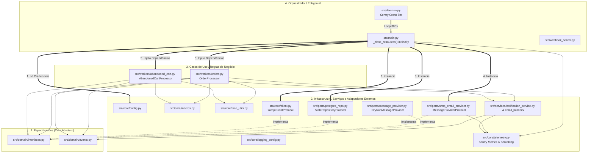

# Árvore de Dependências e Arquitetura do Projeto

Este documento detalha o mapa de dependências de alto nível do sistema, seguindo os princípios estabelecidos na documentação de Clean Architecture e Spec-Driven Development. A regra de ouro é: **A Regra de Negócio (Workers/Domain) não depende de detalhes externos (Banco/APIs); os detalhes externos implementam contratos do domínio.**

## 1. Diagrama de Injeção de Dependências (Hexagonal Architecture)

---

## 2. Fluxo Estrutural de Injeção (Passo a Passo)

A hierarquia de dependências flui de fora (Entrypoint) para dentro (Domain), garantindo desacoplamento total.

### Nível 1: O Domínio (`src/domain/`)
- **Quem é:** O coração da aplicação (`interfaces.py` e `events.py`).
- **Do que depende:** De ninguém.
- **O que faz:** Dita as regras do jogo. Define os `Protocols` (`YampiClientProtocol`, `MessageProviderProtocol`, `StateRepositoryProtocol`) e os DTOs (`OrderTransitionEvent`, `CartTransitionEvent`).

### Nível 2: Infraestrutura e Serviços (`src/core/`, `src/ports/` e `src/services/`)
- **Quem são:** `client.py` (Yampi), `time_utils.py` (UTC-First), `postgres_repo.py` (PostgreSQL com pool e `COALESCE(LEAST(...))`), `smtp_email_provider.py` (SMTP stateful com roteamento dual `oficial@`/`comercial@`, `close()` e telemetria), `message_provider.py` (Dry-Run), `logging_config.py` (`SafeRotatingFileHandler` + Sentry idempotente), `telemetry.py` (contadores Sentry Zero-Crash, spans SMTP, escopos thread-safe e sanitização LGPD) e `notification_service.py` + `email_builders/` (renderização MJML/Jinja2).
- **Do que dependem:** Do `domain/` e de bibliotecas externas (`psycopg2`, `requests`, `smtplib`, `jinja2`, `PyYAML`, `sentry-sdk`, `logging`).
- **O que fazem:** Lidam com o mundo real (Internet, Banco de Dados, E-mail, Renderização, Telemetria e Logs).

### Nível 3: Casos de Uso (`src/workers/`)
- **Quem são:** `abandoned_cart.py` e `orders.py`.
- **Do que dependem:** Estritamente do `domain/` (interfaces e eventos), `core/macros.py`, `core/time_utils.py` e `services/notification_service.py`.
- **O que fazem:** Executam a **Máquina de Estados de E-mails (STG/STC)**, normalizando timestamps em UTC retornados pelo banco, tomando decisões lógicas e acionando notificações com rollback fail-safe em caso de falha de envio.

### Nível 4: Entrypoints (`src/main.py`, `src/daemon.py` e `src/webhook_server.py`)
- **Quem são:** Os roteadores e orquestradores principais.
- **Do que dependem:** De **todos** os módulos necessários para montar o grafo de dependências.
- **O que fazem:** `src/main.py` lê `config.py`, instancia `PostgresStateRepository`, `YampiClient` e `SMTPEmailProvider`/`DryRunMessageProvider`, injeta-os nos workers e garante o encerramento das conexões e o envio dos buffers de telemetria (`_close_resources()` + `flush_telemetry()`) em bloco `finally`. `src/daemon.py` executa `run_all()` a cada 300s com Sentry Crons.
