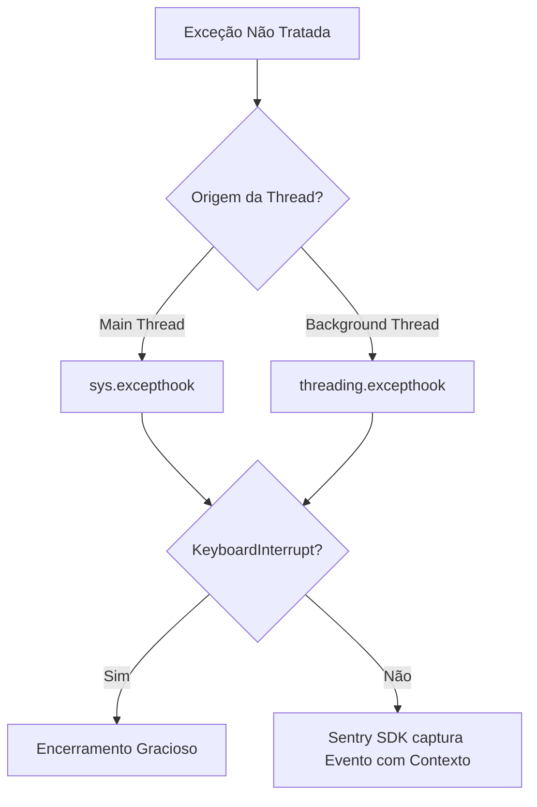
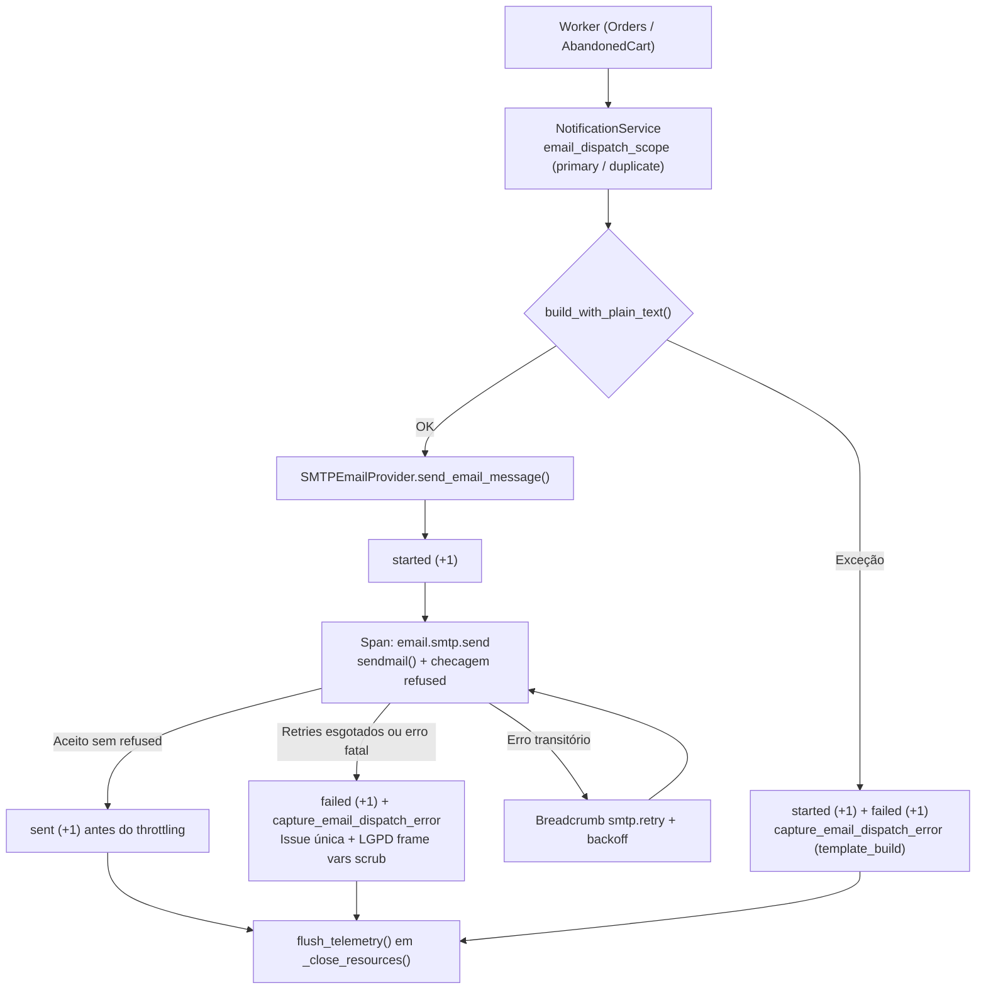

# Especificação Técnica de Telemetria e Observabilidade (Sentry)

**Status:** Ativo / Produção  
**Padrão:** Spec-Driven Architecture  
**Módulos Responsáveis:** `src/core/logging_config.py`, `src/core/telemetry.py`, `src/daemon.py`, `src/main.py`, `src/webhook_server.py`, `src/ports/postgres_repo.py`, `src/ports/smtp_email_provider.py`, `src/services/notification_service.py`, `src/core/client.py`, `src/workers/`  
**Documentos Relacionados:** [`docs/sdd_specs.md`](./sdd_specs.md) e [`docs/architecture.md`](./architecture.md).

---

## 1. Visão Geral e Contrato de Telemetria

O sistema utiliza o **Sentry SDK** (`v2.66.1+`) como infraestrutura primária e exclusiva de telemetria para:
1. **Rastreamento de Falhas e Erros Globais (Error Tracking)**: Interceptação determinística em threads principais e assíncronas.
2. **Performance e Rastreamento Distribuído (APM - Spans & Transactions)**: Medição de latência em milissegundos para chamadas HTTP externas e queries no PostgreSQL.
3. **Sinal de Vida do Processo (Sentry Crons / Heartbeats)**: Monitoramento de liveness do daemon cíclico de recuperação.
4. **Rastreabilidade de Negócio (Breadcrumbs)**: Gravação de transições de estados (`STG` e `STC`) sem geração de ruído ou falsos positivos.

---

## 2. Invariantes de Configuração e Ambiente (`.env`)

A inicialização da telemetria é governada por três variáveis de ambiente obrigatórias:

| Variável | Tipo | Padrão | Descrição e Invariante |
| :--- | :--- | :--- | :--- |
| `SENTRY_DSN` | `string` | `None` | Endpoint HTTPS de ingestão do projeto no Sentry. Se ausente, o sistema opera em modo isolado/offline sem falhas. |
| `TRACES_SAMPLE_RATE` | `float` | `1.0` | Taxa de amostragem de APM (0.0 a 1.0). `1.0` representa 100% de captura de spans. |
| `ENVIRONMENT` | `string` | `"production"` | Segmentador de métricas (`production`, `staging`, `development`). Previne poluição de dados reais com testes locais. |

---

## 3. Arquitetura de Interceptação e Segurança (LGPD)

### 3.1. Zero-Crash, Idempotência & Data Scrubbing
A inicialização em [`src/core/logging_config.py`](../src/core/logging_config.py) cumpre os seguintes requisitos contratuais:
- **Inicialização Idempotente (`_SENTRY_INITIALIZED`)**: Garante que múltiplas chamadas a `setup_logging()` (inclusive entre importações de `main.py` e `daemon.py`) inicializem `sentry_sdk.init()` apenas uma vez.
- **`send_default_pii=False`**: É estritamente proibido enviar dados pessoais identificáveis (CPF, nomes, dados de cartão ou credenciais) nos payloads de telemetria.
- **Supressão de Stack Trace em Disco**: Em caso de erros fatais globais, a stack trace completa é encaminhada para o Sentry e os logs em disco registram tipo e valor sem despejar credenciais em texto claro no `app.log`.

### 3.2. Hooks Globais de Exceção Não Tratada


---

## 4. Catálogo de Transações e Spans de Performance (APM)

O sistema instrumenta manualmente operações críticas de I/O para garantir visibilidade da cascata de execução (*Waterfall Chart*):

```mermaid
gantt
    title Cascata Típica de Execução (Ciclo do Daemon)
    dateFormat X
    axisFormat %s s
    section API Yampi
    GET /abandoned-carts (op: http.client) : 0, 350
    section Banco de Dados
    Postgres upsert_from_cart (op: db.sql.query) : 350, 365
    section Máquina de Estados
    Breadcrumb STC0 -> STC1 (categoria: cart_state_machine) : 365, 366
    section Envio
    SMTP / WhatsApp Dispatch : 366, 500
```



### 4.1. Tabela de Spans Instrumentados

| Operação (`op`) | Localização no Código | Descrição / Payload |
| :--- | :--- | :--- |
| `http.client` | [`src/core/client.py`](../src/core/client.py) | Medição de latência e status code de cada requisição HTTP para a API REST da Yampi. |
| `db.sql.query` | [`src/ports/postgres_repo.py`](../src/ports/postgres_repo.py) | Medição de tempo de execução de queries, inserts e updates no PostgreSQL. |
| `email.smtp.send` | [`src/ports/smtp_email_provider.py`](../src/ports/smtp_email_provider.py) · [`src/core/telemetry.py`](../src/core/telemetry.py) | Medição de latência por tentativa SMTP (`_connect` + `sendmail`), com metadados não-PII (`smtp.host`, `smtp.port`, `smtp.attempt`, `smtp.account_slot`, `email.channel`). |
| `/webhook` | [`src/webhook_server.py`](../src/webhook_server.py) | Transação Flask capturada via `FlaskIntegration` para requisições recebidas da Meta WhatsApp API. |

---

## 5. Especificação do Monitor de Vida do Daemon (Sentry Crons)

O orquestrador [`src/daemon.py`](../src/daemon.py) executa em regime de *Heartbeat Monitoring*:

* **Slug Obrigatório:** `yampi-daemon-cycle`
* **Periodicidade:** 5 Minutos (`MACRO_DAEMON_SLEEP_INTERVAL_SEG = 300`)
* **Timezone:** `America/Sao_Paulo`
* **Margem de Tolerância (Grace Period):** 2 Minutos
* **Tempo Limite de Execução (Max Runtime):** 5 Minutos
* **Threshold de Alerta:** 1 falha consecutiva dispara alerta imediato de inatividade.

---

## 6. Especificação de Breadcrumbs (Rastreabilidade de Estados)

Os workers de processamento registram breadcrumbs estruturados após gravação de transição bem-sucedida:

| Categoria | Origem | Estrutura de Dados (`data`) | Finalidade |
| :--- | :--- | :--- | :--- |
| `order_state_machine` | [`src/workers/orders.py`](../src/workers/orders.py) | `{"order_id": str, "cart_id": str, "new_stg": int, "previous_stg": int \| None}` | Contextualiza exatamente qual pedido, carrinho e transição de STG ocorreram no ciclo. |
| `cart_state_machine` | [`src/workers/abandoned_cart.py`](../src/workers/abandoned_cart.py) | `{"cart_id": str, "new_stc": int, "previous_stc": int \| None}` | Registra transições de STC (4h, 24h, 48h, 96h) para auditoria de réguas de desconto. |
| `smtp.retry` | [`src/ports/smtp_email_provider.py`](../src/ports/smtp_email_provider.py) | `{"attempt": int, "max_retries": int, "error_type": str, "smtp_code": int \| omitido, "channel": str, "recipient_domain": str}` | Registra cada falha transitória de tentativa SMTP antes do *backoff*, sem expor o e-mail completo do destinatário. |
| `src.workers.*` | Sistema de Logs (`logging`) | Mensagens de nível `INFO` ou `WARNING` | Histórico sequencial do pipeline de lote antes de qualquer falha. |

---

## 7. Application Metrics (Contadores de Disparo de E-mail)

O módulo [`src/core/telemetry.py`](../src/core/telemetry.py), integrado ao [`src/services/notification_service.py`](../src/services/notification_service.py) e ao [`src/ports/smtp_email_provider.py`](../src/ports/smtp_email_provider.py), emite contadores de aplicação no Sentry (`sentry_sdk.metrics.count`) sob política **Zero-Crash** e conformidade LGPD (`send_default_pii=False`). Ao final dos ciclos em [`src/main.py`](../src/main.py) (`_close_resources`) e [`src/debug_main.py`](../src/debug_main.py), `flush_telemetry()` drena os buffers pendentes.

> **Nota sobre Dry-Run:** O provedor simulado [`DryRunMessageProvider`](../src/ports/message_provider.py) **não** emite métricas `email.dispatch.*`, evitando poluição dos indicadores de produção durante simulações locais.



### 7.1. Catálogo de Métricas de Disparo

| Métrica | Tipo | Momento de Emissão | Origem | Finalidade |
| :--- | :--- | :--- | :--- | :--- |
| `email.dispatch.started` | `counter` (`+1`) | 1 vez no início de `SMTPEmailProvider.send_email_message()` (ou em `NotificationService` caso o `template_builder` falhe) | [`smtp_email_provider.py`](../src/ports/smtp_email_provider.py) · [`notification_service.py`](../src/services/notification_service.py) | Contabilizar todas as tentativas de disparo iniciadas. |
| `email.dispatch.sent` | `counter` (`+1`) | Imediatamente após `sendmail()` confirmar aceitação (e após validar ausência de `refused`), **antes** do `time.sleep` de *throttling* | [`smtp_email_provider.py`](../src/ports/smtp_email_provider.py) | Medir volume exato de e-mails entregues ao servidor SMTP. |
| `email.dispatch.failed` | `counter` (`+1`) | Em falha de montagem do template (`template_build`), esgotamento de *retries* SMTP (`smtp_retries_exhausted`) ou exceção fatal fora do loop (`smtp_fatal`) | [`smtp_email_provider.py`](../src/ports/smtp_email_provider.py) · [`notification_service.py`](../src/services/notification_service.py) | Contabilizar disparos perdidos e classificar a causa raiz. |

### 7.2. Atributos e Tags Compartilhados (Zero PII)

Todos os dados enviados para métricas, spans, tags e contextos respeitam estritamente a LGPD (nunca enviam e-mail cru, nome do cliente, CPF, senha SMTP ou corpo HTML):

| Chave | Onde Aparece | Valores / Origem | Descrição |
| :--- | :--- | :--- | :--- |
| `email.flow` | Tag, Atributo de Scope/Métrica, Contexto `email_dispatch` | `"order"` \| `"abandoned_cart"` | Fluxo de negócio originador do disparo. |
| `email.template` | Tag, Atributo de Scope/Métrica, Contexto `email_dispatch` | ex.: `"pedido_aprovado"`, `"cupom_pedido_1"`, `"carrinho_abandonado_cupom4"` | Identificador do template Jinja2 selecionado. |
| `email.stage` | Tag, Atributo de Scope/Métrica, Contexto `email_dispatch` | `"STG_<n>"` \| `"STC_<n>"` | Estágio exato da máquina de estados que motivou o e-mail. |
| `email.channel` | Tag, Atributo de Scope/Métrica, Contexto `email_dispatch` | `"transactional"` \| `"promotional"` | Canal derivado de `is_promotional`. |
| `email.dispatch_kind` | Tag, Atributo de Scope/Métrica, Contexto `email_dispatch` | `"primary"` \| `"duplicate"` | Diferencia o envio ao cliente da cópia de supervisão. |
| `email.entity_type` | Atributo de Scope/Métrica, Contexto `email_dispatch` | `"order"` \| `"cart"` | Tipo da entidade vinculada. |
| `email.entity_id` | Atributo de Scope/Métrica, Contexto `email_dispatch` | `str(order_id)` \| `str(cart_id)` | Identificador primário da entidade. |
| `email.order_number` | Atributo de Scope/Métrica, Contexto `email_dispatch` | `str` (quando presente) | Número amigável do pedido na Yampi. |
| `email.cart_id` | Atributo de Scope/Métrica, Contexto `email_dispatch` | `str` (quando presente) | ID do carrinho (extraído de `metadata.data` em pedidos ou `cart_id` em carrinhos). |
| `email.recipient_domain` | Atributo de Scope/Métrica, Contexto `email_dispatch` | ex.: `"gmail.com"`, `"unknown"` | Domínio em minúsculas após o último `@` (zero PII). |
| `email.provider` | Atributo de Métrica, Tag em erro SMTP | `"smtp"` \| `"template_builder"` | Componente onde o evento ocorreu. |
| `smtp.host` / `smtp.port` | Atributo de Métrica, Span, Contexto `smtp_dispatch` | ex.: `"smtp.yourprovider.com"`, `465` | Servidor e porta SMTP utilizados. |
| `smtp.account_slot` | Atributo de Métrica (`sent`/`failed`), Tag, Span, Contexto `smtp_dispatch` | `"primary"` \| `"promo"` | Pool SMTP selecionado pelo roteamento dual. |
| `smtp.attempts` | Atributo de Métrica (`sent`/`failed`), Contexto `smtp_dispatch` | `1..MACRO_SMTP_MAX_RETRIES` | Quantidade de tentativas executadas até sucesso ou esgotamento. |
| `smtp.code` | Atributo de Métrica (`failed`), Tag de Issue, Contexto `smtp_dispatch` | ex.: `535`, `550` (quando aplicável) | Código numérico da resposta SMTP extraído da exceção. |
| `email.failure_stage` | Atributo de Métrica (`failed`), Tag de Issue | `"template_build"` \| `"smtp_retries_exhausted"` \| `"smtp_fatal"` | Estágio exato em que o disparo abortou. |
| `email.error_type` | Atributo de Métrica (`failed`), Tag de Issue | ex.: `"SMTPAuthenticationError"`, `"SMTPRecipientsRefused"` | Nome da classe da exceção capturada. |

### 7.3. Queries Prontas para Dashboards e Alertas

```text
# 1. Total diário de e-mails enviados com sucesso (agrupado por fluxo, template e canal)
sum(email.dispatch.sent) by (email.flow, email.template, email.channel)

# 2. Falhas de disparo por estágio, classe de erro e código SMTP
sum(email.dispatch.failed) by (email.failure_stage, email.error_type, smtp.code, email.flow)

# 3. Fórmula de travamento / disparos inacabados (alerta quando > 0 de forma persistente)
# Indica processos encerrados abruptamente ou bloqueados no meio do envio entre started e sent/failed
sum(email.dispatch.started) - sum(email.dispatch.sent) - sum(email.dispatch.failed)

# 4. Taxa de sucesso de entrega SMTP (%)
(sum(email.dispatch.sent) / sum(email.dispatch.started)) * 100
```

**Filtros recomendados na aba Issues (Sentry):**

```text
# Todas as falhas de envio de e-mail em produção
is:unresolved environment:production has:email.failure_stage

# Falhas exclusivas de autenticação ou rejeição SMTP (ex.: 535 / 550)
email.failure_stage:smtp_retries_exhausted smtp.code:535
email.failure_stage:smtp_retries_exhausted email.error_type:SMTPRecipientsRefused

# Falhas de montagem de template Jinja2
email.failure_stage:template_build

# Isolar apenas disparos primários de pedidos ou carrinhos abandonados
email.flow:order email.dispatch_kind:primary
email.flow:abandoned_cart email.dispatch_kind:primary
```

### 7.4. Como Investigar e Reproduzir um Erro a Partir da Issue

1. **Identifique o contexto de negócio (`Additional Data / Contexts -> email_dispatch`):**
   - Leia `flow` (`order` ou `abandoned_cart`), `template_name`, `stage` (`STG_*` ou `STC_*`), `entity_id`, `order_number`, `cart_id`, `dispatch_kind` e `recipient_domain`.
   - Com `entity_id` / `order_number` / `cart_id`, localize o payload exato na tabela `email_status_table` do PostgreSQL ou na API da Yampi sem precisar expor o e-mail pessoal do cliente no Sentry.
2. **Inspecione o contexto de transporte (`Contexts -> smtp_dispatch`):**
   - Verifique `host`, `port`, `channel`, `account_slot` (`primary` vs `promo`), `attempts`, `message_id`, `smtp_code`, `smtp_error` e a lista `retry_history` (com o erro sanitizado de cada tentativa).
3. **Correlacione os Breadcrumbs e o Traceback:**
   - Na linha do tempo de *Breadcrumbs*, observe a sequência `order_state_machine` / `cart_state_machine` e os eventos `smtp.retry` indicando exatamente o que oscilou antes da falha definitiva.
   - No *Stacktrace*, navegue diretamente até a linha exata em `concrete_builders.py`, `notification_service.py` ou `smtp_email_provider.py` (o *traceback* é preservado integralmente via `capture_email_dispatch_error`, sem duplicação com o log de erro graças à `DedupeIntegration` e ao uso de `logger.warning` no `NotificationService`).
4. **Reproduza localmente em ambiente seguro:**
   - Utilize os parâmetros observados (`template_name`, `stage`, `entity_id`) em um teste unitário ou via [`src/debug_main.py`](../src/debug_main.py) com `MACRO_ENABLE_REAL_EMAIL_DISPATCH = False` (ou servidor SMTP mockado) e `ENVIRONMENT=development` para reproduzir o erro sem disparar mensagens a clientes reais.

---

## 8. Matriz de Consulta Rápida (Cheat Sheet de Filtros)

Para agentes e desenvolvedores formulando queries de telemetria no Sentry:

```text
# Erros não resolvidos em produção
is:unresolved environment:production

# Falhas de disparo de e-mail por estágio ou fluxo
has:email.failure_stage environment:production
email.flow:order email.failure_stage:smtp_retries_exhausted

# Chamadas à API da Yampi
transaction.op:http.client

# Consultas no Banco de Dados PostgreSQL
transaction.op:db.sql.query

# Tentativas de envio SMTP
span.op:email.smtp.send

# Requisições ao Servidor de Webhook Flask
transaction:/webhook

# Monitor de Cron do Daemon
cron.slug:yampi-daemon-cycle
```
